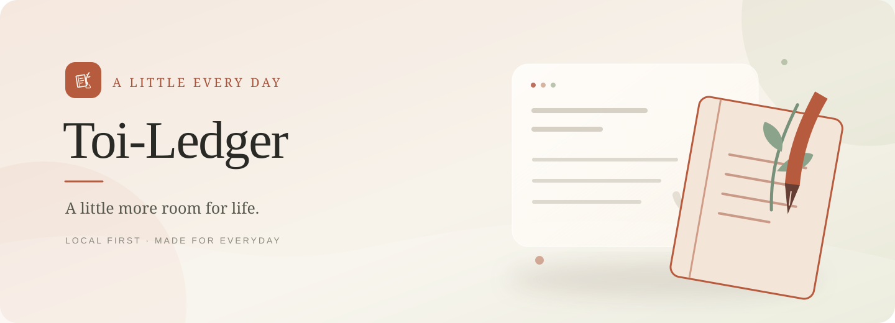
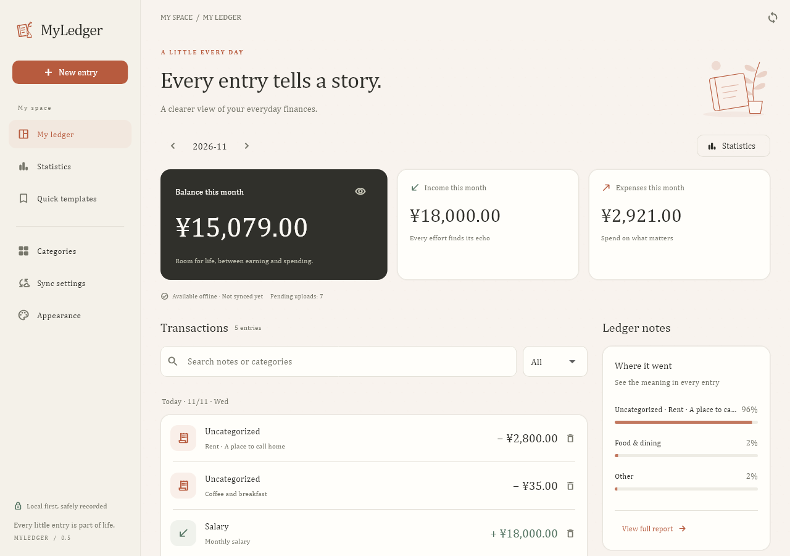
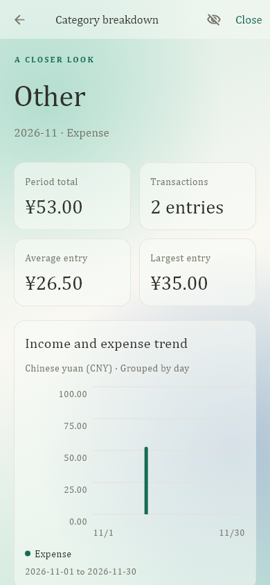
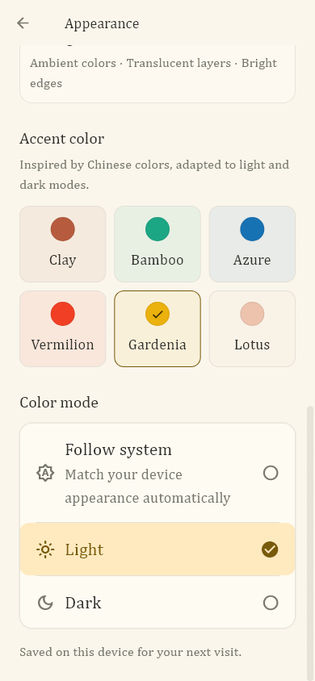
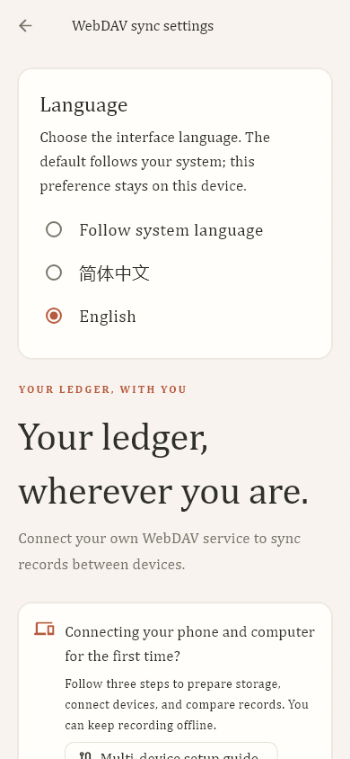

# Toi-Ledger

**Every little entry is part of everyday life.**

A personal ledger for Android and Windows. Keep your records locally, understand everyday income and expenses, and connect your phone and computer through a WebDAV service you control.

**Simple records · Local first · Your own sync**

[简体中文](README.md) · [Downloads](https://github.com/Toicar/Toi-Ledger/releases) · [Report an issue](https://github.com/Toicar/Toi-Ledger/issues)

> Current version: **0.5.2+13 · Prerelease**. The repository is named Toi-Ledger; the application display name, Windows executable, and parts of the source still use **MyLedger**. The application supports Simplified Chinese and English, follows the system language by default, and can be switched instantly in Sync settings.

## Contents

- [Preview](#preview)
- [Features](#features)
- [Download and installation](#download-and-installation)
- [Start recording](#start-recording)
- [Multi-device sync](#multi-device-sync)
- [Data and privacy](#data-and-privacy)
- [Development and builds](#development-and-builds)
- [Project structure](#project-structure)
- [Current status and limitations](#current-status-and-limitations)
- [Feedback and contributions](#feedback-and-contributions)

## Preview

These interfaces are rendered with fictional ledger data. Mobile images show a mobile-sized preview.



| Category breakdown | Appearance and accent colors | Language and sync settings |
| --- | --- | --- |
|  |  |  |

## Features

| Area | Available functionality |
| --- | --- |
| Daily records | Income and expenses with an amount, date, and optional note; editing, deletion, month filters, and keyword search. Categories are optional. |
| Categories | Create, rename, archive, and change a category between income and expense. Changing its type does not reverse historical transactions. |
| Quick templates | Save recurring entry details with optional amounts and categories. Selecting a category sets the matching income/expense type; applying a template still requires confirmation. |
| Statistics | Calendar week/month/year trends, previous-period comparisons, category shares, and detailed breakdowns with search, sorting, and access to transaction editing. |
| Uncategorized entries | Individual uncategorized transactions **≥ ¥500** appear separately by default; smaller entries are grouped as Other. The threshold is adjustable. |
| Interface language | Simplified Chinese / English / Follow system (default), instant switching, persisted preferences, and localized date pickers and messages. |
| Appearance | System/light/dark modes, paper-textured matte and translucent glass surfaces, six accent palettes, and an option to hide amounts. |
| Multi-device sync | Incremental HTTPS WebDAV operation logs, offline recording, conflict handling, connection tests, and setup guidance. |

Accent palettes include Clay (陶土), Bamboo (竹绿), Azure (群青), Vermilion (胭脂红), Gardenia (栀子黄), and Lotus (藕荷). Text uses system fonts and fallbacks; no additional body or heading font files are bundled.

## Download and installation

Get the appropriate file from [Releases](https://github.com/Toicar/Toi-Ledger/releases). The current [v0.5.2 prerelease](https://github.com/Toicar/Toi-Ledger/releases/tag/v0.5.2) includes:

| Platform / purpose | File | Instructions |
| --- | --- | --- |
| Android ARM64 | `Toi-Ledger-0.5.2-android-arm64.apk` | Transfer it to your phone and install it. Allow installation from the relevant source when Android prompts you. |
| Windows x64 | `Toi-Ledger-0.5.2-windows-x64.zip` | Extract the entire archive and run `my_ledger.exe`. Keep the DLLs, `data`, and other runtime files beside it. |
| LAN WebDAV tools | `Toi-Ledger-0.5.2-webdav-setup.zip` | Use this if you want to host a service yourself. The complete Windows archive also contains a `webdav-setup` folder. |

Generic release packages do not bundle a personal LAN certificate. When upgrading from an older dedicated build with self-signed WebDAV, import your service's public configuration on both devices and verify its fingerprint.

The Android prerelease uses a debug signing key. Close the Windows application before replacing its runtime files. In-place Android updates require the same package identity and signing certificate. If signatures differ, do not uninstall your only copy of the data just to bypass the installation error.

**Update every syncing device to 0.4.2 before changing a category between income and expense.** Older clients cannot read the new category-type-change logs.

## Start recording

1. Open the application, select New entry (记一笔), and choose income or expense.
2. Enter a positive amount, a date, and an optional note. Select a category or leave the transaction uncategorized.
3. Save it, then browse by month, search records, or edit transactions from the home screen.
4. Save frequently used details under Quick templates (快捷模板). Category management and statistics have their own pages.

Select any category, Other, or a separately displayed large uncategorized transaction in statistics to open its detailed breakdown: total, count, average, largest transaction, trend, and individual entries.

### Change the language

Open Sync settings → Language and choose Follow system language, 简体中文, or English. The default follows the system; your choice is stored only on this device and does not change ledger data or other devices. Chinese regional variants use Simplified Chinese, English variants use English, and unmatched system languages fall back to English.

On Windows, `Ctrl+N` opens a new entry from the home screen, and `Ctrl+Enter` saves an entry dialog.

## Multi-device sync

You choose and manage the sync service. Offline recording does not require WebDAV. Devices share the same root directory and ledger ID; they do not exchange database files directly.

### Use an existing WebDAV service

1. Prepare an existing WebDAV root directory accessible over **HTTPS**. Obtain a username and application-specific password with read/write access.
2. On the device holding your primary ledger, open Sync settings (同步设置), enter the root URL and credentials, keep its current ledger ID, and select Verify and save (验证并保存). Return home and select Sync now (立即同步).
3. On another **empty device that has never created transactions or categories**, enter the same root URL and ledger ID, along with credentials that can access the directory. Verify, save, and sync.
4. Compare records for the same month and confirm that new entries travel in both directions.

Test connection (测试连接) does not save the configuration. Verify and save stores it and, when applicable, joins the empty device to that ledger. Deleting every visible transaction does not remove its history or make an existing ledger empty.

The service must support directory creation and listing, reads and writes, deletion of probe files, and atomic `If-None-Match: *` conditional creation. The application runs a connection test. A cloud drive webpage, sharing link, or local sync folder is not a WebDAV URL. Do not manually append the application's operation-log subdirectories.

### Set up a same-network service from scratch

The included wizard targets **one Windows computer and one phone**:

1. Install Python **3.12 or newer** on the computer and connect both devices to the same LAN.
2. Open `webdav-setup` and double-click `Setup-WebDAV.cmd`. The first run downloads service dependencies.
3. Follow the prompts for the computer's and phone's LAN IPv4 addresses. Enter your own dedicated password twice; input is hidden.
4. Open the generated `service-setup.json` in a text editor. On both devices, paste its entire contents into Sync settings → Import WebDAV service configuration (导入 WebDAV 服务配置). Compare the displayed certificate fingerprint with the computer's output before accepting it.
5. Enter the password separately on each device, then connect both to the same ledger using the steps above.

The public configuration contains no password, private key, or ledger ID. Additional certificate trust is restricted to the specified HTTPS origin; it does not install a system root certificate. Hostname/IP and validity checks remain enabled.

The host must be powered on and awake. Windows starts the configured local service before synchronization when its address matches; `Start-WebDAV.cmd` and `Stop-WebDAV.cmd` also provide manual control. The service does not start at system boot. Reserve DHCP addresses for both devices on the router when possible. A LAN-only service is not directly available after leaving that network; cross-network use requires a separately reachable HTTPS WebDAV endpoint.

See the [WebDAV tool guide](tool/local_webdav/README.md) for complete setup, restricted firewall rules, address changes, certificates, and backups. That detailed tool guide is currently in Chinese.

### Sync behavior

- Transactions and categories sync. Language preferences, templates, themes, hidden amounts, and the statistics threshold remain local to each device.
- The application attempts sync at startup, on returning to the foreground, and approximately every 60 seconds while running. Manual sync is available from home. There is no persistent Android background sync service.
- Concurrent edits may create a conflict that requires choosing which version to retain. Conflicted transactions are temporarily excluded from totals; historical operations remain available.
- Two independently populated ledgers cannot be automatically merged. Preserve their data rather than clearing a ledger or uninstalling its only copy to force a connection.

## Data and privacy

- Transactions are stored locally in SQLite; sync credentials use the operating system's secure storage.
- Sync uses HTTPS, but remote operation logs are **plaintext JSON**. Neither the local database nor the remote logs are end-to-end encrypted.
- SHA-256 checksums detect integrity errors. They are not digital signatures and do not protect against a malicious server with permission to rewrite the data.
- The new WebDAV wizard protects its password with the current Windows user's DPAPI and keeps private keys in a restricted local state directory. Do not share private keys, password files, or actual ledgers.
- Sync propagates changes and deletions. **It is not a replacement for an independent backup.** There is no in-app backup/restore wizard yet; preserve your data before uninstalling or migrating.

## Development and builds

### Environment

| Component | Version / requirement |
| --- | --- |
| Flutter / Dart | The development baseline is Flutter **3.35.7** / Dart **3.9.2**. |
| Windows builds | Windows x64, Visual Studio C++ desktop build tools, Windows SDK, and ATL. |
| Android builds | JDK **17**, Android SDK, and the Flutter Android toolchain. |
| WebDAV service tools | Python **3.12+**, needed only for the service and its tests; the application itself does not require Python. |

```sh
git clone https://github.com/Toicar/Toi-Ledger.git
cd Toi-Ledger
flutter pub get --enforce-lockfile
flutter run
```

While the repository is private, cloning and downloading require an authorized GitHub account.

### Build packages

```sh
# Android ARM64 Release
flutter build apk --release --target-platform android-arm64 --target lib/main.dart

# Windows Release (run on Windows)
flutter build windows --release --target lib/main.dart
```

Default outputs are `build/app/outputs/flutter-apk/app-release.apk` and `build/windows/x64/runner/Release/`. The Windows build copies the WebDAV tools into `webdav-setup/`; keep the entire output directory when distributing it.

The current Android Release configuration uses debug signing. Configure and retain a stable release key before distributing your own production builds. A build signed with another key cannot directly replace an installed version with a different signature.

### Developer checks

These are commands developers can run when needed, not a statement that the current release has passed every check:

```sh
dart format --output=none --set-exit-if-changed lib test
flutter analyze --fatal-infos
flutter test --coverage --reporter expanded
```

Some HTTPS tests require `openssl` on PATH; the test environment also needs the SQLite runtime. After changing Drift database definitions, regenerate and commit the generated source:

```sh
dart run build_runner build --delete-conflicting-outputs
```

For service tests, first install `tool/local_webdav/setup-requirements.txt` into an isolated Python virtual environment, then run:

```sh
python -m unittest discover -s tool/local_webdav -p "test_*.py" -v
```

Do not commit `.env` files, signing keys, DPAPI files, private service state, or actual ledger data. Local reports and handoff records are also excluded from published source.

### Localization resources

Edit the Chinese and English entries in `lib/l10n/messages.json`, keep matching placeholders, and regenerate the typed strings:

```sh
python tool/generate_localizations.py
dart format lib/l10n/app_strings.dart
```

Do not translate user content or change domain logs. Language behavior and English layout tests are in `test/language_test.dart`.

## Project structure

```text
lib/
  app/                    Themes, workspace, and shared state
  data/                   SQLite, repositories, credentials, and templates
  domain/                 Operations and statistics models
  l10n/                   Chinese/English resources, typed strings, and display labels
  features/               Entries, categories, templates, statistics, and settings
  sync/                   WebDAV and synchronization logic
assets/branding/          Icons and editable design assets
test/                     Application and sync tests
tool/local_webdav/        LAN service, setup scripts, and service tests
android/ · windows/       Platform projects
docs/                     Development and protocol documentation
```

[See the detailed project tree and module descriptions](docs/PROJECT_STRUCTURE.md).

## Current status and limitations

- **0.5.2 is a prerelease.** The application test suite and strict static analysis have passed for this version. Phone installation and real two-way sync still await acceptance testing. Compatibility with every WebDAV provider is not guaranteed.
- One CNY ledger is supported. Multiple accounts, transfers, budgets, multiple currencies, statement import, and notification parsing are not implemented.
- The UI supports Simplified Chinese and English. Other system languages fall back to English; user category names and notes are never automatically translated.
- Large, long-running operation histories still need performance and storage improvements. There is no log snapshot compaction or automatic ledger merging.

## Feedback and contributions

Use [Issues](https://github.com/Toicar/Toi-Ledger/issues) to report problems or suggest improvements. Include your version, platform, reproduction steps, and expected behavior. Use redacted screenshots; do not attach passwords, keys, or complete ledgers.

Describe the scope and validation of proposed changes. A license and fuller contribution guidelines will be added later; no particular open-source license is currently declared.

More product details, demonstrations, and usage examples will follow.
