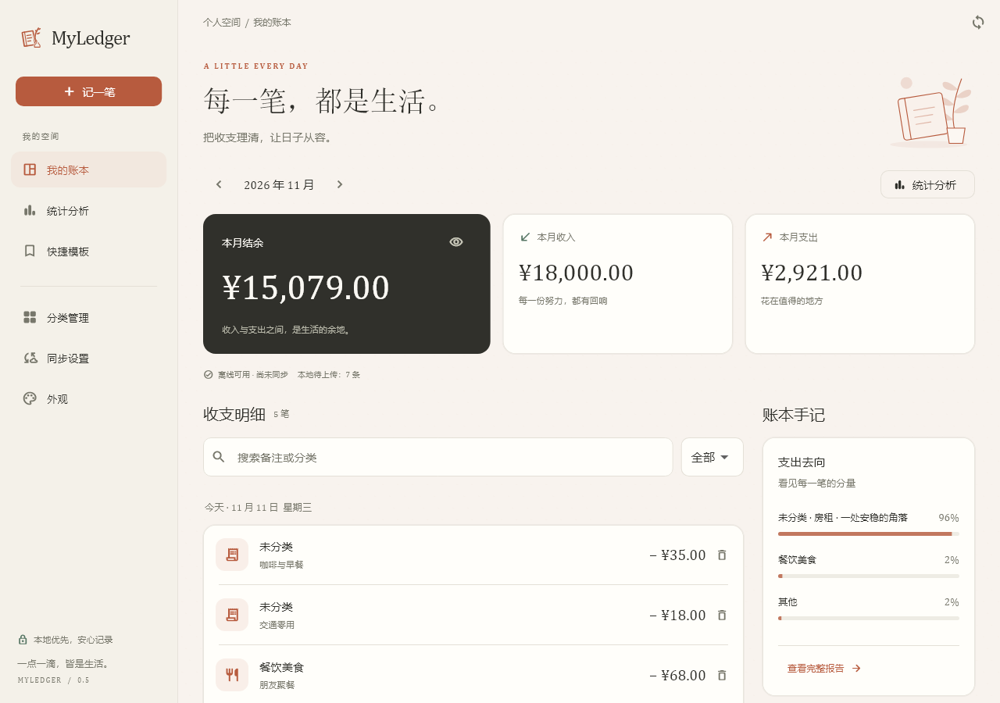
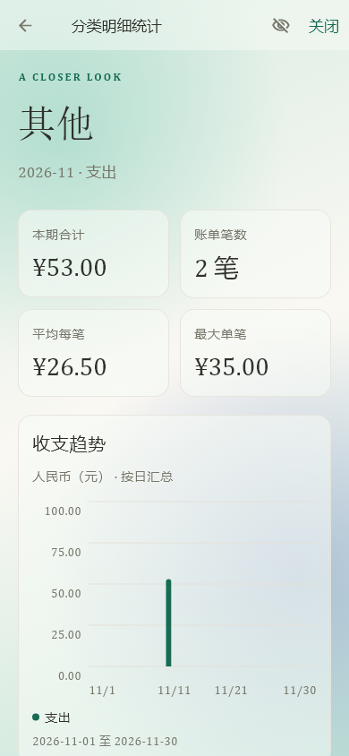
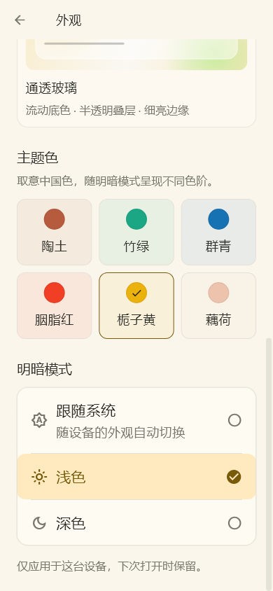
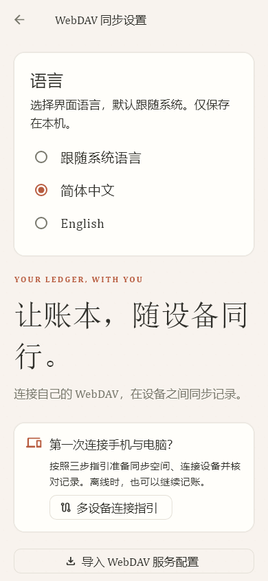

# Toi-Ledger

**一点一滴，皆是生活。**

面向 Android 与 Windows 的个人记账应用。以本地记录为基础，用清晰的收支统计整理日常，也可以通过自己的 WebDAV 服务连接手机与电脑。

**简洁记录 · 本地优先 · 自主同步**

[English](README.en.md) · [下载安装](https://github.com/Toicar/Toi-Ledger/releases) · [反馈问题](https://github.com/Toicar/Toi-Ledger/issues)

> 当前版本：**0.6.1+15 · 预发布**。仓库名为 Toi-Ledger，应用显示名称、可执行文件和部分源码仍沿用 **MyLedger**。应用支持简体中文与 English，默认跟随系统语言，可在同步设置中即时切换。

## 目录

- [界面预览](#界面预览)
- [主要功能](#主要功能)
- [下载安装](#下载安装)
- [开始记账](#开始记账)
- [多设备同步](#多设备同步)
- [软件更新](#软件更新)
- [数据与隐私](#数据与隐私)
- [开发与构建](#开发与构建)
- [项目结构](#项目结构)
- [当前状态与限制](#当前状态与限制)
- [反馈与贡献](#反馈与贡献)

## 界面预览

以下界面使用虚构账目渲染；移动端图片为移动尺寸预览。



| 分类统计明细 | 外观与主题色 | 语言与同步设置 |
| --- | --- | --- |
|  |  |  |

## 主要功能

| 模块 | 当前支持 |
| --- | --- |
| 日常记账 | 收入／支出记录，金额、日期、备注，编辑与删除，月份及关键词筛选；分类可选。 |
| 分类管理 | 新增、改名、归档，以及修改收入／支出类型。分类类型变化不翻转历史账单的收支方向。 |
| 快捷模板 | 保存常用收支；金额和分类可留空。选择分类时自动匹配收支类型，使用后仍需确认才记入账本。 |
| 统计分析 | 自然周／月／年趋势、上一周期对比、分类占比与二级明细，支持搜索、排序和进入账单编辑。 |
| 未分类统计 | 默认单笔 **≥ ¥500** 独立展示，其余合并为“其他”；门槛可自行调整。 |
| 界面语言 | 简体中文／English／跟随系统（默认），即时切换并在重启后保留；日期选择器与提示同步切换。 |
| 外观设置 | 跟随系统／浅色／深色，纸纹磨砂与透明玻璃两种材质，六套主题色，支持隐藏金额。 |
| 多设备同步 | HTTPS WebDAV 增量操作日志、离线记录、冲突处理、连接测试与配置指引。 |
| 软件更新 | 可配置受信任的 HTTPS 更新清单，启动或手动检查，并在确认后下载安装。 |

主题色包括陶土、竹绿、群青、胭脂红、栀子黄与藕荷。文字使用系统字体和回退方案，不额外内嵌正文或标题字库。

## 下载安装

从 [Releases](https://github.com/Toicar/Toi-Ledger/releases) 获取对应文件。现有 [v0.6.0 Release](https://github.com/Toicar/Toi-Ledger/releases/tag/v0.6.0) 已更新为 **0.6.1**，提供：

| 平台／用途 | 文件 | 使用方式 |
| --- | --- | --- |
| Android ARM64 | `Toi-Ledger-0.6.0-android-arm64.apk` | 传到手机安装；按系统提示允许相应来源安装应用。 |
| Windows x64 | `Toi-Ledger-0.6.0-windows-x64.zip` | 完整解压，运行 `my_ledger.exe`。保留同目录 DLL、`data` 和其他运行文件。 |
| 局域网 WebDAV 工具 | `Toi-Ledger-0.6.0-webdav-setup.zip` | 需要自己搭建服务时使用；Windows 完整包也包含 `webdav-setup` 文件夹。 |

通用发布包不内置个人局域网证书；从旧版专用构建升级后，如使用自签名 WebDAV，请在两端导入自己服务的公共配置并核对指纹。

Android 发布包目前使用调试签名，仅供预发布测试；请勿卸载唯一数据副本来解决签名不一致。

更新 Windows 版前先关闭应用，再完整覆盖运行文件。Android 覆盖安装需保留相同包名与签名；遇到签名不一致时，不要通过卸载唯一数据副本来解决。

**所有同步设备请先升级至 0.4.2，再修改分类的收入／支出类型。** 旧客户端不能读取新增的分类类型变更日志。

## 开始记账

1. 打开应用，点击“记一笔”，选择收入或支出。
2. 填写正数金额、日期与可选备注。可以选择分类，也可以保留“未分类”。
3. 保存后，在首页按月份查看流水、搜索记录或编辑账单。
4. 常用内容可保存到“快捷模板”；分类管理与统计分析提供独立入口。

在统计页点击分类、“其他”或独立展示的大额未分类账单，即可进入二级统计，查看合计、笔数、平均每笔、最大单笔、趋势与具体账单。

### 切换语言

打开“同步设置 → 语言”，选择“跟随系统语言”“简体中文”或“English”。首次使用默认跟随系统；选择仅保存在本机，不影响其他设备或账目内容。系统中文各地区使用简体中文，英文各地区使用英文；其余语言回退英文。

Windows 首页支持 `Ctrl+N` 新建记录，记账弹窗支持 `Ctrl+Enter` 保存。

## 多设备同步

同步服务由你选择与管理；离线记账不依赖 WebDAV。手机和电脑通过同一根目录与账本 ID 连接，不直接互相复制数据库。

### 使用已有 WebDAV

1. 准备一个已存在、可通过 **HTTPS** 访问的 WebDAV 根目录，取得有读写权限的用户名与应用专用密码。
2. 在保留主账本的设备打开“同步设置”，填写根目录与凭据，保留当前账本 ID，点击“验证并保存”，再回首页“立即同步”。
3. 在另一台**从未创建账目或分类的空设备**中填写同一根目录与账本 ID，以及可访问该目录的凭据，验证保存后同步。
4. 核对两端相同月份的记录，并分别确认新增记录可以同步到另一端。

“测试连接”不保存配置。“验证并保存”才保存配置，并在需要时让空设备加入该账本。删除全部账单并不会消除历史，因此不能把有历史的设备当作空设备加入。

服务须支持创建目录、列举、读写与删除探测文件，以及原子 `If-None-Match: *` 条件创建；应用会进行连接测试。普通网盘网页、分享链接或本地同步文件夹不能代替 WebDAV URL。不要手工追加账本日志子目录。

### 从零搭建同一 Wi-Fi 服务

内置向导面向**一台 Windows 电脑与一部手机**：

1. 电脑安装 Python **3.12 或以上**，手机与电脑连接同一局域网。
2. 打开 `webdav-setup`，双击 `Setup-WebDAV.cmd`。首次会联网安装服务依赖。
3. 按提示填写电脑与手机的局域网 IPv4，并隐藏输入两次自己设置的专用密码。
4. 用记事本打开生成的 `service-setup.json`，在两端“同步设置 → 导入 WebDAV 服务配置”粘贴全文。对照电脑显示的证书指纹，再确认填入。
5. 两端单独输入密码，按上面的步骤连接同一账本。

公共配置不包含密码、私钥或账本 ID。证书信任仅用于指定 HTTPS origin，不安装系统根证书；仍会校验证书地址与有效期。

服务主机需要开机且不能休眠。Windows 应用在已保存地址与本机服务匹配时会在同步前自动启动服务；也可用 `Start-WebDAV.cmd` 和 `Stop-WebDAV.cmd` 手动控制。服务不会随系统开机启动。建议在路由器为电脑和手机保留 DHCP 地址。同一 Wi-Fi 方案离开该局域网后不能直接同步，跨网络使用需要另外准备可达的 HTTPS WebDAV 服务。

首次设置、有限防火墙规则、IP 变化、证书与备份的完整说明见 [WebDAV 设置工具](tool/local_webdav/README.md)。

### 同步行为

- 同步账目与分类；语言、快捷模板、主题、隐藏金额和统计门槛分别保存在各设备。
- 应用启动、恢复前台及运行期间约每 60 秒尝试同步，也可在首页手动触发；不提供 Android 常驻后台同步服务。
- 并发修改可能产生冲突，需要选择保留的版本；冲突账目暂不计入汇总，历史操作仍保留。
- 当前不支持自动合并两个各自已有记录的账本。请保留原数据，不要清库或卸载来强行连接。

## 软件更新

在“同步设置 → 软件更新”填写受信任的 HTTPS 清单地址。未配置时不查询更新；配置后启动应用会检查新版本，也可手动检查。Windows 更新需关闭并重启应用，Android 使用系统安装器。更新清单与安装包需同源，大小和 SHA-256 会在安装前校验。

**请只使用可信更新源。** 摘要用于检查下载完整性，不能验证发布者身份；源服务器被入侵时，恶意更新仍可能通过检查。完整格式、限制和发布步骤见 [更新说明](docs/UPDATES.md)。

## 数据与隐私

- 账目保存在本机 SQLite；同步凭据使用系统安全存储。
- 同步使用 HTTPS，远端操作日志为**明文 JSON**；本机数据库与远端日志均没有端到端加密。
- SHA-256 用于日志完整性检错，不是数字签名，不能抵御有权限的恶意服务端篡改。
- 新 WebDAV 向导用当前 Windows 用户的 DPAPI 保存密码，私钥留在受限的本机状态目录。不要共享私钥、密码文件或真实账本。
- 同步会传播删除与修改，**不能替代独立备份**。当前没有应用内备份恢复向导；卸载或迁移前先妥善保留数据。

## 开发与构建

### 环境

| 项目 | 版本／要求 |
| --- | --- |
| Flutter / Dart | 项目开发基线为 Flutter **3.35.7** / Dart **3.9.2**。 |
| Windows 构建 | Windows x64、Visual Studio C++ 桌面开发工具、Windows SDK 与 ATL。 |
| Android 构建 | JDK **17**、Android SDK 与 Flutter Android 工具链。 |
| WebDAV 服务工具 | Python **3.12+**；仅运行服务／服务测试需要，应用本身不依赖 Python。 |

```sh
git clone https://github.com/Toicar/Toi-Ledger.git
cd Toi-Ledger
flutter pub get --enforce-lockfile
flutter run
```

仓库为私有时，克隆和下载需要相应 GitHub 账号权限。

### 构建安装包

```sh
# Android ARM64 Release
flutter build apk --release --target-platform android-arm64 --target lib/main.dart

# Windows Release（在 Windows 上执行）
flutter build windows --release --target lib/main.dart
```

默认输出为 `build/app/outputs/flutter-apk/app-release.apk` 与 `build/windows/x64/runner/Release/`。Windows 构建会将 WebDAV 工具复制到输出目录的 `webdav-setup/`；分发时请保留完整目录。

当前 Android Release 配置沿用调试签名。自行正式分发前应配置稳定的发布密钥，妥善保留签名材料；换用其他密钥的构建不能直接覆盖现有签名不同的安装。

### 开发验证

以下为开发者按需执行的命令，并不表示当前版本已经全部通过：

```sh
dart format --output=none --set-exit-if-changed lib test
flutter analyze --fatal-infos
flutter test --coverage --reporter expanded
```

部分 HTTPS 测试需要 `openssl` 位于 PATH；测试环境也需要 SQLite 运行库。修改 Drift 数据库定义时，更新并提交生成文件：

```sh
dart run build_runner build --delete-conflicting-outputs
```

服务测试需先在独立 Python 虚拟环境安装 `tool/local_webdav/setup-requirements.txt`，再执行：

```sh
python -m unittest discover -s tool/local_webdav -p "test_*.py" -v
```

不要提交 `.env`、签名密钥、DPAPI 文件、服务私有状态或真实账本；本机报告与交接资料也不属于公开源码内容。

### 本地化资源

修改 `lib/l10n/messages.json` 中的中英文资源，保留相同的占位符，再生成类型化代码：

```sh
python tool/generate_localizations.py
dart format lib/l10n/app_strings.dart
```

不要翻译用户内容或改变领域日志。语言行为和英文布局测试位于 `test/language_test.dart`。

## 项目结构

```text
lib/
  app/                    主题、工作区与全局状态
  data/                   SQLite、仓储、凭据与模板
  domain/                 账目操作与统计模型
  l10n/                   中英文资源、类型化文案与显示标签
  features/               记账、分类、模板、统计和设置页面
  sync/                   WebDAV 与同步逻辑
assets/branding/          图标与可编辑设计资源
test/                     应用与同步测试
tool/local_webdav/        局域网服务、设置脚本与服务测试
android/ · windows/       平台工程
docs/                     开发与协议说明
```

[查看包含各模块和文件作用的详细工作树](docs/PROJECT_STRUCTURE.md)。

## 当前状态与限制

- 当前为 **0.6.1 预发布版**。应用完整测试与严格静态分析已通过；手机安装与真实双向同步仍待验收，不承诺所有 WebDAV 提供方兼容。
- 当前支持单个人民币账本；多账户、转账、预算、多币种、账单导入与通知识别尚未实现。
- 界面支持简体中文与 English；未匹配的系统语言回退英文，用户分类名和备注不自动翻译。
- 大量长期日志仍有性能与存储优化空间；没有日志快照压缩或自动账本合并。

## 反馈与贡献

欢迎通过 [Issues](https://github.com/Toicar/Toi-Ledger/issues) 反馈问题或提出建议。请说明版本、平台、复现步骤与预期行为；截图使用脱敏数据，不附密码、密钥或完整账本。

提交改动前说明范围与验证情况。许可证与更完整的贡献约定待后续补充；当前不声明采用任何特定开源许可证。

更多产品介绍、演示与使用案例将在后续完善。
